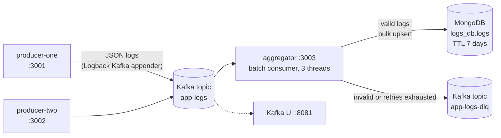

# Distributed Log Aggregation System

A centralized logging pipeline built with **Apache Kafka**, **Spring Boot**, and **MongoDB**. Services publish structured JSON logs straight to Kafka, and an aggregator service consumes them in batches, validates them, and stores them in MongoDB with automatic 7-day expiry. Records that cannot be processed are routed to a dead-letter topic instead of being lost.


-black.svg)


---

## Table of Contents

- [Overview](#overview)
- [Architecture](#architecture)
- [Log Event Schema](#log-event-schema)
- [Reliability and Data Handling](#reliability-and-data-handling)
- [Tech Stack](#tech-stack)
- [Project Structure](#project-structure)
- [Getting Started](#getting-started)
- [Verifying the Pipeline](#verifying-the-pipeline)
- [Configuration](#configuration)
- [Running Without Docker for the Apps](#running-without-docker-for-the-apps)
- [Design Decisions](#design-decisions)
- [Known Limitations](#known-limitations)
- [Roadmap](#roadmap)
- [License](#license)

---

## Overview

Each application in a distributed system writes logs to its own place, which makes it hard to search across services or follow a request end to end. This project collects them in one place:

- **Producers** are ordinary Spring Boot services. A Logback appender sends every log line to Kafka, so there are no agents, sidecars, or log files to collect.
- **Kafka** decouples producers from the aggregator. If the aggregator is down or slow, logs wait in the topic instead of being dropped.
- **The aggregator** reads logs in batches, validates and maps them, and writes them to MongoDB in bulk.
- **MongoDB** stores the logs with indexes on the fields you search by and a TTL index that deletes entries after 7 days.
- **Kafka UI** lets you inspect topics, messages, and consumer lag in a browser.

## Architecture



### Data flow

1. A producer calls `log.info(...)`. The Logback Kafka appender encodes the event as JSON and publishes it to the `app-logs` topic asynchronously.
2. The aggregator's listener receives a **batch** of events and passes it to the processing service.
3. Each event is mapped to a document and validated. Invalid events go to the `app-logs-dlq` topic with a failure reason.
4. Valid documents are written to MongoDB in one **bulk upsert**, keyed by a deterministic ID.
5. Only after the write succeeds does the listener **acknowledge** the batch, so offsets move forward only for data that is stored.
6. If the batch fails, it is retried (3 attempts, 2 seconds apart). If retries are exhausted, the records are sent to the DLQ.

## Log Event Schema

Producers emit JSON with this shape, which the aggregator reads as a `LogEvent`:

| Field | Type | Description |
|---|---|---|
| `id` | string, optional | Ignored by the aggregator, which generates its own ID |
| `timestamp` | ISO-8601 instant | When the log was written (UTC). **Required** |
| `serviceName` | string | Name of the emitting service. **Required, not blank** |
| `logLevel` | string | `INFO`, `WARN`, `ERROR`, and so on |
| `traceId` | string, optional | Correlation ID, read from the logging MDC key `traceId` |
| `message` | string | The log message |
| `durationMs` | number, optional | Duration of the operation, if the producer supplies it |
| `metadata` | object | Extra fields such as thread name, logger class, and stack trace. Unknown top-level fields are also collected here |

Example document in MongoDB:

```json
{
  "_id": "5b1c1c0e-3b8e-3c1a-9a0a-0d4f6f6f1a11",
  "timestamp": "2026-01-15T10:42:07.318Z",
  "serviceName": "ProducerOneApplication",
  "logLevel": "INFO",
  "traceId": null,
  "message": "Sending message to Kafka: hello",
  "durationMs": null,
  "metadata": { "thread": "http-nio-3001-exec-1", "loggerClass": "com.myorg.Controller.TestController" }
}
```

## Reliability and Data Handling

| Concern | How it is handled |
|---|---|
| **Producer durability** | `acks=all`, idempotent producer (`enable.idempotence=true`), effectively unlimited retries bounded by a 120 s delivery timeout |
| **Producer throughput** | Asynchronous delivery, `lz4` compression, 10 ms linger, 64 KB batches |
| **Consumer throughput** | Batch listener, 3 concurrent consumer threads, one bulk MongoDB write per batch |
| **No acknowledgement before storage** | Manual acknowledgement (`MANUAL_IMMEDIATE`) happens only after the bulk write succeeds |
| **Duplicate delivery** | Each document ID is a deterministic UUID derived from `serviceName`, `timestamp`, and `traceId`, and writes are upserts, so replaying a batch does not create duplicates |
| **Poison messages** | Deserialization is wrapped in an `ErrorHandlingDeserializer`, and invalid records are routed to the DLQ instead of blocking the partition |
| **Validation** | Records without a timestamp or with a missing or blank service name are rejected to the DLQ with a reason code (`MISSING_TIMESTAMP`, `MISSING_SERVICE_NAME`, `BLANK_SERVICE_NAME`, `MAPPING_FAILED`) |
| **Transient failures** | Failed batches are retried 3 times with a 2-second fixed back-off, then sent to the DLQ as `RETRY_EXHAUSTED` |
| **Retention** | A TTL index on `timestamp` removes documents after 7 days. Kafka retention is capped at 1 GB |
| **Searchability** | Indexes on `serviceName`, `logLevel`, and `traceId` |

### Dead-letter topic

Failed records are published to `app-logs-dlq` as an envelope:

```json
{
  "failedEvent": { "...original event..." },
  "failureReason": "MISSING_SERVICE_NAME",
  "timestamp": "2026-01-15T10:42:09.120Z"
}
```

## Tech Stack

| Layer | Technology |
|---|---|
| Language and runtime | Java 21 |
| Framework | Spring Boot 3.5 (Web, Spring for Apache Kafka, Spring Data MongoDB) |
| Messaging | Apache Kafka 7.5 (Confluent image) in KRaft mode, no ZooKeeper |
| Storage | MongoDB 8.0 |
| Log shipping | Logback with `logback-kafka-appender` and `logstash-logback-encoder` |
| Observability | Kafka UI |
| Packaging | Maven, multi-stage Docker builds, Docker Compose |

## Project Structure

```
distributed-log-aggregation-system/
├── Infrastructure/
│   ├── docker-compose.yml        # Kafka, Kafka UI, MongoDB, 2 producers, aggregator
│   └── .env.example              # copy to .env and edit
├── aggregator/                   # consumes, validates, stores logs
│   └── src/main/java/com/myorg/
│       ├── Consumer/             # LogConsumer: batch @KafkaListener
│       ├── Service/              # processing, storage (bulk upsert), DLQ publishing
│       ├── Validator/            # LogValidator
│       ├── mapper/               # LogEvent -> LogDocument, deterministic ID
│       ├── document/             # LogDocument (MongoDB collection "logs", indexes, TTL)
│       ├── common/               # LogEvent record
│       ├── config/               # Kafka consumer/producer, retry and DLQ error handler
│       └── api/Controller/       # reserved for query and admin endpoints
├── log-producer-one/             # demo service that ships JSON logs to Kafka
├── log-producer-two/             # second demo service
├── kafka-communication-flow.txt  # notes on Docker vs host Kafka listeners
└── README.md
```

## Getting Started

### Prerequisites

- Docker 20.10+ and Docker Compose v2
- Free ports: `3001`, `3002`, `3003`, `8081`, `9092`, `27017`
- Java 21 and Maven 3.8+ only if you run the apps outside Docker

### 1. Clone and configure

```bash
git clone https://github.com/AhmedAymannn/distributed-log-aggregation-system.git
cd distributed-log-aggregation-system/Infrastructure
cp .env.example .env
```

Open `.env` and set a strong `MONGO_ROOT_PASSWORD`. Keep the same password inside `MONGODB_URI`.

### 2. Start everything

```bash
docker compose up --build
```

This builds the three Spring Boot images and starts Kafka (KRaft), Kafka UI, MongoDB, both producers, and the aggregator. The first build downloads Maven dependencies and takes a few minutes.

### 3. Send some logs

```bash
curl "http://localhost:3001/send?message=hello-from-producer-one"
curl "http://localhost:3001/send?message=another-log"
```

Each request writes a log line, which the Logback Kafka appender publishes to the `app-logs` topic.

### 4. Stop

```bash
docker compose down        # keep stored data
docker compose down -v     # also delete the MongoDB volume
```

## Verifying the Pipeline

**Kafka UI** at <http://localhost:8081>

- Topics, then `app-logs`, then Messages: the raw JSON events
- Consumers, then `aggregator-group`: consumer lag (should return to 0)
- Topics, then `app-logs-dlq`: rejected records and their reasons

**MongoDB**

```bash
docker exec -it log_aggregator_db mongosh -u admin --authenticationDatabase admin logs_db
```

```javascript
db.logs.find().sort({ timestamp: -1 }).limit(5)
db.logs.countDocuments({ serviceName: "ProducerOneApplication" })
db.logs.getIndexes()          // should list the TTL index on "timestamp"
```

**Aggregator logs**

```bash
docker logs -f aggregator
# Received batch of N logs
# Bulk write successful. N documents saved.
```

**Dead-letter topic from the command line**

```bash
docker exec -it kafka kafka-console-consumer \
  --bootstrap-server kafka:29092 --topic app-logs-dlq --from-beginning
```

## Configuration

### Environment variables (`Infrastructure/.env`)

| Variable | Purpose |
|---|---|
| `KAFKA_CLUSTER_ID` | KRaft cluster ID |
| `MONGO_ROOT_USER`, `MONGO_ROOT_PASSWORD` | MongoDB root credentials |
| `MONGODB_URI` | Connection string used when running the aggregator outside Docker |
| `PORT_KAFKA` | Kafka port exposed to the host (`9092`) |
| `PORT_KAFKA_UI` | Kafka UI port (`8081`) |
| `PORT_PRODUCER_ONE`, `PORT_PRODUCER_TWO`, `PORT_AGGREGATOR` | Host ports for the apps (`3001`, `3002`, `3003`) |

### Ports

| Service | Host port |
|---|---|
| producer-one | 3001 |
| producer-two | 3002 |
| aggregator | 3003 |
| Kafka UI | 8081 |
| Kafka (host listener) | 9092 |
| MongoDB | 27017 |

### Kafka listeners

Kafka exposes two listeners so that both containers and host processes can connect:

| Used by | Address |
|---|---|
| Containers on the Compose network | `kafka:29092` |
| Applications running on your machine | `localhost:9092` |

Inside Compose, the apps receive `SPRING_KAFKA_BOOTSTRAP_SERVERS=kafka:29092`. See `kafka-communication-flow.txt` for a walkthrough.

### Aggregator behaviour (`KafkaConsumerConfig`)

| Setting | Value |
|---|---|
| Topic | `app-logs` |
| Consumer group | `aggregator-group` |
| Listener type | Batch |
| Concurrency | 3 threads (effective parallelism is limited by the topic's partition count) |
| Acknowledgement | Manual, after a successful write |
| Retry | Fixed back-off, 2 s, 3 attempts |
| Dead-letter topic | `app-logs-dlq` |

## Running Without Docker for the Apps

Start only the infrastructure, then run the Spring Boot apps on your machine:

```bash
cd Infrastructure
docker compose up -d kafka kafka-ui mongodb
```

```bash
# in three terminals
cd aggregator && MONGODB_URI="mongodb://<user>:<password>@localhost:27017/logs_db?authSource=admin" mvn spring-boot:run
cd log-producer-one && mvn spring-boot:run
cd log-producer-two && mvn spring-boot:run
```

The apps default to `localhost:9092` for Kafka.

## Design Decisions

- **Direct producer-to-Kafka logging.** No file tailing or agents, which means fewer moving parts and lower latency. The cost is that the application's logging path depends on Kafka being reachable, which is why delivery is asynchronous and the console appender stays enabled.
- **Kafka between producers and storage.** It absorbs bursts and lets the aggregator fall behind or restart without losing logs.
- **At-least-once consumption with idempotent writes.** Offsets are acknowledged after the database write, and deterministic IDs with upserts make replays safe.
- **Bulk writes.** One round trip per batch instead of one per log line.
- **Dead-letter topic instead of dropping or blocking.** Bad records are preserved with a reason and do not hold up the rest of the stream.
- **KRaft mode.** A single Kafka process, with no ZooKeeper to run.
- **MongoDB with a TTL index.** Flexible document shape for log metadata and built-in retention.

## Known Limitations

- Single Kafka broker with replication factor 1, and plaintext listeners. This is a development setup, not a production deployment.
- No authentication on Kafka, Kafka UI, or the application endpoints.
- The `/admin` query and administration controllers are placeholders. Logs are currently read through MongoDB or Kafka UI.
- Document IDs are derived from `serviceName`, `timestamp`, and `traceId`. Two logs from the same service with the same millisecond timestamp and no `traceId` map to the same ID.
- Dead-letter publishing is not transactional with offset commits, so retried batches can produce duplicate DLQ entries.
- There are no automated tests yet.

## Roadmap

- [ ] Query API: search by service, level, trace ID, and time range, with pagination
- [ ] Automated tests: unit tests for mapping and validation, Testcontainers integration tests for Kafka and MongoDB
- [ ] Consumer lag and processing metrics with Micrometer, Prometheus, and Grafana
- [ ] Correlation IDs propagated across services through the logging MDC
- [ ] Multi-partition topics, and keying by service name for per-service ordering
- [ ] CI pipeline with GitHub Actions
- [ ] Security: authenticated Kafka listeners and a secured admin API

## License

MIT. See the `LICENSE` file.

## Author

**Ahmed Ayman**: [GitHub](https://github.com/AhmedAymannn)
